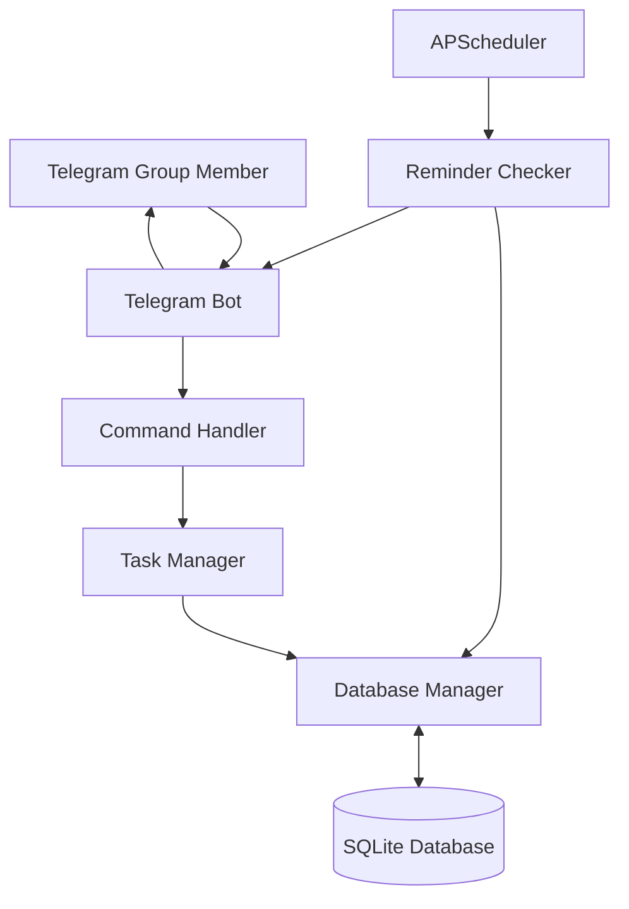

# PingTask – System Design

## 1. System Architecture

PingTask follows a modular architecture in which each component is responsible for a specific function.

The architecture separates Telegram communication, command processing, task management, database operations, and scheduled reminder processing.

## 2. Main System Components

### 2.1 Telegram Bot Interface

Responsible for:
- Receiving Telegram messages.
- Receiving bot commands.
- Sending responses to group members.
- Displaying task information.
- Delivering reminder notifications.

Technology: python-telegram-bot.

### 2.2 Command Handler

Responsible for:
- Identifying incoming commands.
- Extracting command arguments.
- Validating user input.
- Calling appropriate task management functions.
- Formatting bot responses.

Python module: `handlers.py`

### 2.3 Task Manager

Responsible for:
- Creating tasks.
- Retrieving pending tasks.
- Retrieving personal tasks.
- Updating task statuses.
- Validating task information.
- Applying task-related business rules.

Python module: `task_manager.py`

### 2.4 Database Manager

Responsible for:
- Establishing SQLite connections.
- Creating database tables.
- Inserting task records.
- Retrieving task records.
- Updating task information.
- Managing database transactions.

Python module: `database.py`

### 2.5 Background Scheduler

Responsible for:
- Running periodic background checks.
- Identifying tasks approaching their deadlines.
- Triggering reminder notifications.
- Preventing duplicate reminders.
- Excluding completed and overdue tasks.

Technology: APScheduler.

Python module: `scheduler.py`

### 2.6 Configuration Manager

Responsible for:
- Loading the Telegram bot token.
- Loading environment variables.
- Managing timezone configuration.
- Providing application settings.

Python module: `config.py`

### 2.7 SQLite Database

Responsible for persistently storing task information, including task assignments, deadlines, statuses, and reminder information.

## 3. System Architecture Diagram

## 4. Main System Workflows

### 4.1 Task Creation Workflow

1. A user enters the `/todo` command.
2. Telegram forwards the command to the bot.
3. The command handler extracts the task information.
4. The task manager validates the information.
5. The date parser converts the deadline into a datetime object.
6. The database manager saves the task.
7. The bot sends a confirmation message.

### 4.2 View Tasks Workflow

1. A user enters `/tasks`.
2. The command handler identifies the request.
3. The task manager retrieves pending tasks.
4. The database manager queries SQLite.
5. The task manager processes the results.
6. The bot formats and displays the tasks.

### 4.3 Personal Tasks Workflow

1. A user enters `/mytasks`.
2. The bot identifies the Telegram user ID.
3. The task manager retrieves tasks assigned to that user.
4. Results are filtered by the current Telegram group.
5. The bot displays the personal task list.

### 4.4 Task Completion Workflow

1. A user enters `/done [Task ID]`.
2. The command handler extracts the task ID.
3. The task manager checks whether the task exists.
4. The system verifies group ownership and user permissions.
5. The database manager updates the task status.
6. The bot sends a confirmation message.

### 4.5 Automated Reminder Workflow

1. APScheduler triggers the reminder checking function.
2. The system retrieves pending tasks that have not received reminders.
3. The reminder checker compares the current time with the task deadlines.
4. Eligible tasks are selected.
5. The bot sends reminder notifications.
6. The database records successful reminder delivery.
7. The scheduler waits for the next execution.

## 5. Proposed Python Modules

| File | Responsibility |
|---|---|
| `bot.py` | Initialize and run the Telegram bot |
| `handlers.py` | Handle Telegram commands |
| `task_manager.py` | Implement task management logic |
| `database.py` | Handle SQLite operations |
| `scheduler.py` | Manage background reminders |
| `config.py` | Load application configuration |

## 6. Design Considerations

- Use asynchronous functions for Telegram bot operations.
- Keep command handlers separate from business logic.
- Keep database operations separate from Telegram communication.
- Use parameterized SQL queries.
- Store timestamps consistently in UTC.
- Convert timestamps to the configured timezone when displaying them.
- Avoid blocking the asynchronous event loop.
- Prevent duplicate reminder delivery.
- Verify task ownership before modifying records.
- Handle Telegram API errors appropriately.

## 6.1 Implementation Notes

- The reminder check is registered on python-telegram-bot's job queue, which runs on APScheduler. It runs every 10 minutes, starting 30 seconds after the bot starts.
- Telegram errors are logged by a single error handler in `bot.py`. Network errors are logged as warnings without a traceback.
- The bot token is never logged. Request logging for `httpx` is set to `WARNING`, because request URLs contain the token.
- Commands are plain-text replies, so usernames and task text are not parsed as Markdown.

## 7. Future Improvements

Possible future enhancements include:

- Task editing.
- Task deletion.
- Task priority levels.
- Multiple reminder intervals.
- Recurring tasks.
- Task completion statistics.
- Administrator controls.
- Web-based task dashboard.